# 모듈 간 인터페이스

> 이 파일은 `tools/gen_interfaces.py` 가 `aple/schema.py` 로부터 자동 생성한다. **직접 고치지 않는다.**
> 인터페이스를 바꾸려면 `aple/schema.py` 의 클래스와 `FLOWS` 표를 고친다.

## 데이터 흐름

| 보내는 모듈 | 받는 모듈 | 데이터 | 필드 |
|---|---|---|---|
| M0 공통 인프라 · Piper Studio 연동 · 역할 A·B | M1 인식 · 3D 위치 · 역할 A | `SceneSnapshot` | `scene_id`, `source`, `capture_mode`, `color`, `depth_m`, `intrinsics`, `stamp_s`, `tray_clear`, `apple_id`, `view_index`, `tool_pose` |
| M0 공통 인프라 · Piper Studio 연동 · 역할 A·B | M2 색상 품질 판별 · 역할 C | `LightingStatus` | `light_state`, `delta_e`, `card_valid` |
| M1 인식 · 3D 위치 · 역할 A | M2 색상 품질 판별 · 역할 C | `AppleDetection2D` | `scene_id`, `det_id`, `bbox`, `confidence`, `mask` |
| M1 인식 · 3D 위치 · 역할 A | M2 색상 품질 판별 · 역할 C | `AppleState` | `scene_id`, `apple_id`, `det_id`, `center_m`, `diameter_m`, `top_surface_z_m`, `clearance_m`, `fit_residual_m`, `confidence`, `depth_valid_ratio`, `displacement_m`, `occluded` |
| M1 인식 · 3D 위치 · 역할 A | M5 판단 · 계획 · 역할 B·D·A | `AppleState` | `scene_id`, `apple_id`, `det_id`, `center_m`, `diameter_m`, `top_surface_z_m`, `clearance_m`, `fit_residual_m`, `confidence`, `depth_valid_ratio`, `displacement_m`, `occluded` |
| M1 인식 · 3D 위치 · 역할 A | M5 판단 · 계획 · 역할 B·D·A | `BoxOccupancy` | `scene_id`, `box_id`, `rows`, `cols`, `cell_pitch_m`, `wall_height_m`, `wall_height_measured_m`, `origin_m`, `heights_m`, `occupied`, `valid` |
| M2 색상 품질 판별 · 역할 C | M5 판단 · 계획 · 역할 B·D·A | `GradeResult` | `scene_id`, `apple_id`, `grade`, `ratio`, `ratio_lo`, `ratio_hi`, `coverage`, `margin`, `reject_reason`, `final`, `inspect_mode`, `variety` |
| M5 판단 · 계획 · 역할 B·D·A | M4 공정 관리 · 통합 담당 | `TaskItem` | `scene_id`, `apple_id`, `action`, `grade`, `grade_scene_id` |
| M5 판단 · 계획 · 역할 B·D·A | M4 공정 관리 · 통합 담당 | `GraspProfile` | `scene_id`, `apple_id`, `size_bin`, `est_mass_kg`, `open_width_m`, `grasp_height_offset_m`, `grasp_force_n`, `effort`, `feasible` |
| M5 판단 · 계획 · 역할 B·D·A | M4 공정 관리 · 통합 담당 | `PlacementPlan` | `scene_id`, `apple_id`, `box_id`, `cell_index`, `place_center_m`, `hover_z_m`, `release_z_m`, `planned_drop_m`, `feasible` |
| M4 공정 관리 · 통합 담당 | M3 로봇 실행 · 손상 방지 · 역할 B·D | `PlacementPlan` | `scene_id`, `apple_id`, `box_id`, `cell_index`, `place_center_m`, `hover_z_m`, `release_z_m`, `planned_drop_m`, `feasible` |
| M4 공정 관리 · 통합 담당 | M3 로봇 실행 · 손상 방지 · 역할 B·D | `GraspProfile` | `scene_id`, `apple_id`, `size_bin`, `est_mass_kg`, `open_width_m`, `grasp_height_offset_m`, `grasp_force_n`, `effort`, `feasible` |
| M3 로봇 실행 · 손상 방지 · 역할 B·D | M0 공통 인프라 · Piper Studio 연동 · 역할 A·B | `ArmCommand` | `position_rad`, `gripper_width_m`, `gripper_effort`, `cmd_source` |
| M3 로봇 실행 · 손상 방지 · 역할 B·D | M4 공정 관리 · 통합 담당 | `ExecResult` | `success`, `failure_code`, `phase_reached`, `slip_count` |

## 데이터 구조

```mermaid
classDiagram
    direction LR
    class SceneSnapshot {
        +int scene_id
        +Source source
        +CaptureMode capture_mode
        +ndarray color
        +ndarray depth_m
        +tuple~float,float,float,float~ intrinsics
        +float stamp_s
        +bool tray_clear
        +int apple_id
        +int view_index
        +ndarray? tool_pose
    }
    class LightingStatus {
        +LightState light_state
        +float delta_e
        +bool card_valid
    }
    class AppleDetection2D {
        +int scene_id
        +int det_id
        +tuple~int,int,int,int~ bbox
        +float confidence
        +ndarray mask
    }
    class AppleState {
        +int scene_id
        +int apple_id
        +int det_id
        +tuple~float,float,float~ center_m
        +float diameter_m
        +float top_surface_z_m
        +float clearance_m
        +float fit_residual_m
        +float confidence
        +float depth_valid_ratio
        +float displacement_m
        +bool occluded
    }
    class BoxOccupancy {
        +int scene_id
        +Grade box_id
        +int rows
        +int cols
        +float cell_pitch_m
        +float wall_height_m
        +float wall_height_measured_m
        +tuple~float,float,float~ origin_m
        +list~float~ heights_m
        +list~bool~ occupied
        +bool valid
    }
    class ColorRatio {
        +int scene_id
        +int apple_id
        +InspectMode inspect_mode
        +float ratio
        +float ratio_lo
        +float ratio_hi
        +float coverage
        +float view_disagreement
        +int num_views
        +str variety
    }
    class GradeResult {
        +int scene_id
        +int apple_id
        +Grade grade
        +float ratio
        +float ratio_lo
        +float ratio_hi
        +float coverage
        +float margin
        +RejectReason reject_reason
        +bool final
        +InspectMode inspect_mode
        +str variety
    }
    class GraspProfile {
        +int scene_id
        +int apple_id
        +int size_bin
        +float est_mass_kg
        +float open_width_m
        +float grasp_height_offset_m
        +float grasp_force_n
        +int effort
        +bool feasible
    }
    class TaskItem {
        +int scene_id
        +int apple_id
        +TaskAction action
        +Grade? grade
        +int grade_scene_id
    }
    class PlacementPlan {
        +int scene_id
        +int apple_id
        +Grade box_id
        +int cell_index
        +tuple~float,float,float~ place_center_m
        +float hover_z_m
        +float release_z_m
        +float planned_drop_m
        +bool feasible
    }
    class ArmCommand {
        +tuple~float,float,float,float,float,float~ position_rad
        +float gripper_width_m
        +int gripper_effort
        +str cmd_source
    }
    class ExecResult {
        +bool success
        +FailureCode failure_code
        +Phase phase_reached
        +int slip_count
    }
    class CycleRecord {
        +int cycle_index
        +int scene_id
        +int apple_id
        +str variety
        +InspectionPolicy inspection_policy
        +TaskAction task_action
        +str backend
        +float diameter_m
        +float ratio
        +float ratio_lo
        +float ratio_hi
        +float coverage
        +Grade grade
        +RejectReason reject_reason
        +Grade target_box
        +int target_cell
        +float grasp_force_set_n
        +float planned_drop_m
        +float settle_error_m
        +float t_scan_s
        +float t_plan_s
        +float t_pick_s
        +float t_inspect_s
        +float t_place_s
        +float t_total_s
        +bool success
        +FailureCode failure_code
        +FailStage fail_stage
    }
    class Source {
        <<enumeration>>
        TOP
        IN_HAND
    }
    class CaptureMode {
        <<enumeration>>
        FULL
        POSE_ONLY
    }
    class Grade {
        <<enumeration>>
        UPPER
        MIDDLE
        REJECT
    }
    class RejectReason {
        <<enumeration>>
        NONE
        BORDERLINE
        VIEW_DISAGREE
        OVERSIZE
        UNDERSIZE
        LOW_CONF
        LOW_COVERAGE
        OCCLUDED
        UNSAFE_GRASP
    }
    class InspectMode {
        <<enumeration>>
        TOP_SINGLE
        IN_HAND_MULTI
    }
    class InspectionPolicy {
        <<enumeration>>
        NEVER
        ALWAYS
        ADAPTIVE
    }
    class TaskAction {
        <<enumeration>>
        PICK_PLACE
        PICK_INSPECT_PLACE
        DEFER
        SKIP
    }
    class Phase {
        <<enumeration>>
        IDLE
        APPROACH
        DESCEND
        GRASP
        LIFT
        TRANSIT
        HOVER
        SOFT_LAND
        RELEASE
        RETREAT
        INSPECT
        MOVE_NAMED
    }
    class FailureCode {
        <<enumeration>>
        NONE
        IK_FAIL
        COLLISION
        NO_CONTACT
        SLIP
        DROP
        TIMEOUT
        GATE_VIOLATION
        ABORTED
        NOT_HOLDING
        HOVER_NOT_REACHED
        SCENE_MISMATCH
    }
    class FailStage {
        <<enumeration>>
        NONE
        D1
        D2
        G1
        C1
        C2
        P1
        F1
        F2
        F3
        F4
    }
    class LightState {
        <<enumeration>>
        OK
        CORRECTING
        FAULT
    }
    SceneSnapshot --> Source : source
    SceneSnapshot --> CaptureMode : capture_mode
    LightingStatus --> LightState : light_state
    BoxOccupancy --> Grade : box_id
    ColorRatio --> InspectMode : inspect_mode
    GradeResult --> Grade : grade
    GradeResult --> RejectReason : reject_reason
    GradeResult --> InspectMode : inspect_mode
    TaskItem --> TaskAction : action
    TaskItem --> Grade : grade
    PlacementPlan --> Grade : box_id
    ExecResult --> FailureCode : failure_code
    ExecResult --> Phase : phase_reached
    CycleRecord --> InspectionPolicy : inspection_policy
    CycleRecord --> TaskAction : task_action
    CycleRecord --> Grade : grade
    CycleRecord --> RejectReason : reject_reason
    CycleRecord --> Grade : target_box
    CycleRecord --> FailureCode : failure_code
    CycleRecord --> FailStage : fail_stage
```

