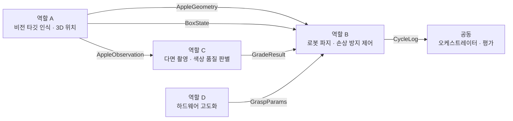
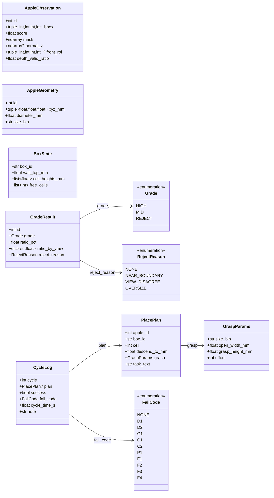

# 모듈 간 인터페이스

> 이 파일은 `tools/gen_interfaces.py` 가 `aple/schema.py` 로부터 자동 생성한다. **직접 고치지 않는다.**
> 인터페이스를 바꾸려면 `aple/schema.py` 의 클래스와 `FLOWS` 표를 고친다.

## 데이터 흐름

| 보내는 역할 | 받는 역할 | 데이터 | 필드 |
|---|---|---|---|
| 역할 A · 비전 타깃 인식 · 3D 위치 | 역할 C · 다면 촬영 · 색상 품질 판별 | `AppleObservation` | `id`, `bbox`, `score`, `mask`, `normal_z`, `front_roi`, `depth_valid_ratio` |
| 역할 A · 비전 타깃 인식 · 3D 위치 | 역할 B · 로봇 파지 · 손상 방지 제어 | `AppleGeometry` | `id`, `xyz_mm`, `diameter_mm`, `size_bin` |
| 역할 A · 비전 타깃 인식 · 3D 위치 | 역할 B · 로봇 파지 · 손상 방지 제어 | `BoxState` | `box_id`, `wall_top_mm`, `cell_heights_mm`, `free_cells` |
| 역할 C · 다면 촬영 · 색상 품질 판별 | 역할 B · 로봇 파지 · 손상 방지 제어 | `GradeResult` | `id`, `grade`, `ratio_pct`, `ratio_by_view`, `reject_reason` |
| 역할 D · 하드웨어 고도화 | 역할 B · 로봇 파지 · 손상 방지 제어 | `GraspParams` | `size_bin`, `open_width_mm`, `grasp_height_mm`, `effort` |
| 역할 B · 로봇 파지 · 손상 방지 제어 | 공동 · 오케스트레이터 · 평가 | `CycleLog` | `cycle`, `plan`, `success`, `fail_code`, `cycle_time_s`, `note` |

## 데이터 구조

